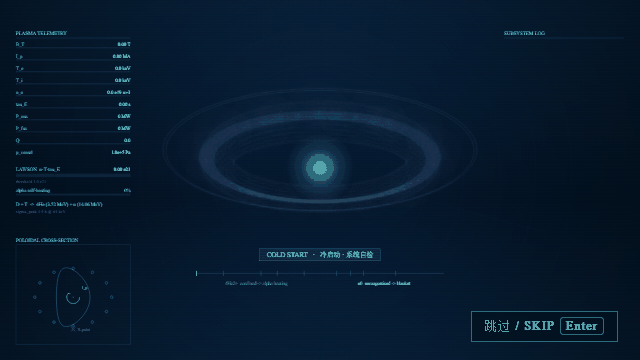

# 托卡马克点火启动动画 · Tokamak Ignition Boot Animation

科幻风格的启动（splash）动画：主题是**磁约束聚变（托卡马克）**，
以聚变控制室 HUD 的形式呈现一次完整的「冷启动 → 等离子体击穿 → 聚变点火 → 自持燃烧 → 浮现标识」序列。



- 时长 **9.2 秒**，**随时可按 `Enter` 打断**
- 风格：**托卡马克控制室 HUD**，冷蓝/青色等离子体、磁场线圈、遥测数据流
- **零依赖**：单个 HTML 文件，双击即可播放，不需要服务器、不需要联网、不需要构建
- 也可作为 **DeepSeek Harness** 的启动插件安装（**应用更新后不会丢失**）

---

## 〇、只想下载就能用？

下载这一个文件，双击打开即可：

```
dist/dsh-boot-intro.html
```

它是**完全自包含**的（渲染器已内联，0 个外部引用）。想换成自己的产品名：

```
dist/dsh-boot-intro.html?title=YOUR%20PRODUCT&sub=your%20tagline
```

其他 URL 参数：`?t=5.4` 定格到某一时刻、`?loop=1` 循环、`?speed=4` 加速。

---

## 一、快速预览（不影响任何已安装的东西）

直接双击打开：

```
dsh-boot-animation/boot-animation.html
```

可选 URL 参数：

| 参数 | 作用 | 例子 |
| --- | --- | --- |
| `?t=<秒>` | 只渲染该时刻的**单帧**（用于截图/核对） | `?t=5.4` |
| `?loop=1` | 循环播放 | `?loop=1` |
| `?speed=<倍数>` | 加速播放 | `?speed=4` |

按 `Enter` 或点右下角按钮即可跳过。

---

## 二、安装到 DSH（这样才会在真实启动时播放）

```powershell
node dsh-boot-animation/plugin/manage.mjs install
```

然后**重启 DeepSeek Harness**。

其他命令：

```powershell
node dsh-boot-animation/plugin/manage.mjs status      # 查看当前状态（不改动任何东西）
node dsh-boot-animation/plugin/manage.mjs uninstall   # 卸载，恢复原样
```

安装脚本会先把 profile 清单备份成 `package.json.backup-<时间戳>`，再写入。
卸载脚本会把插件目录和注册项都移除。

---

## 三、为什么更新不会丢

DSH 桌面端每次更新会用 NSIS 安装包**整体替换安装目录** `D:\deepseekAPP`
（含 `resources\app.asar`、`resources\runtime\**`、exe、DLL）。

而本插件**完全不碰安装目录**，它装在用户 profile 里：

```
C:\Users\<你>\.dsh\profiles\desktop\node_modules\dsh-boot-intro\
```

并把包名登记进 `C:\Users\<你>\.dsh\profiles\desktop\package.json` 的
`dsh.profile.bundles`。更新程序不会触碰 `~/.dsh`，所以：

> **应用升级后，动画依然是启动动画，无需重新安装。**

这也是选择「插件」而不是「改 `app.asar`」的根本原因 —— 直接改 `app.asar`
每次更新都会被覆盖掉，无法满足「更新后不丢失」。

---

## 四、它在启动流程里的位置（说实话的部分）

DSH 的真实启动顺序是：主窗口**隐藏创建** → 加载 Web UI → 拉起 host 子进程并装载插件
→ 显示主窗口（自带 "HARNESS / Loading plugins…" 启动画面）→ 应用就绪。

本动画注册在 **`shell.overlay`** 槽位（覆盖全应用的最上层浮层），因此：

- ✅ 它覆盖整个主窗口，是**真实的启动画面**，并会盖住自带的 "Loading plugins…" 瞬时画面
- ✅ 每次启动播放一次（用 `sessionStorage` 记账，HMR 重载不会重播）
- ✅ 播放期间是模态的（`pointerEvents: auto`），应用不会被误点
- ⚠️ 它**无法早于主窗口的第一帧**：插件代码只在宿主启动后才注入。
  想要「窗口出现之前」就有画面，需要另做一个独立的置顶无边框辅助进程
  （DSH 里已有先例：`dsh-pet` 自带 `runtime/electron-helper`）。见第七节。

---

## 五、物理内容（不是随便画的光效）

画面上的数字与过程都按真实托卡马克参数推进（ITER 量级）：

| 量 | 过程 |
| --- | --- |
| 纵场 `B_T` | 0 → **5.30 T**（18 个环向场线圈依次加电） |
| 等离子体电流 `I_p` | 0 → **15.02 MA** |
| 电子/离子温度 `T_e / T_i` | 0.02 → **20.1 / 18.4 keV** |
| 电子密度 `n_e` | 0 → **10.2 × 10¹⁹ m⁻³** |
| 能量约束时间 `τ_E` | 0 → **3.72 s** |
| 聚变增益 `Q = P_fus / P_aux` | 0 → **10.4**（ITER 目标 Q=10） |
| 劳森三重积 `n·T·τ_E` | 越过 **3 × 10²¹ keV·s/m³** 点火阈值 |

**核心物理看点 —— 两种聚变产物的输运差异**（大多数动画会画错）：

```
D + T  →  ⁴He (3.52 MeV) + n (14.06 MeV)        σ_peak ≈ 4.9 b @ 64 keV
```

- **⁴He²⁺ 带电** → 被磁场束缚，沿螺旋磁力线**向内回旋**，把 3.52 MeV 沉积为**α 自加热**
  （画面上是金黄色的向内螺旋径迹）
- **n⁰ 中性** → 完全不受磁场影响，**沿直线逃逸**穿出等离子体打到包层
  （画面上是白色直线 + 打到壁上时的包层俘获涟漪）

此外还画了：D 形极向截面（含 X 点）、嵌套磁通面、安全因子 q≈3.1 的螺旋磁力线、
以及 5.2–5.7 s 的 **m/n=3/2 磁岛锯齿不稳定性**（琥珀色告警后由反馈抑制）。

---

## 六、目录结构

```
dsh-boot-animation/
├── boot-animation.html        独立预览页（双击即可看）
├── tokamak-boot.js            渲染器本体（唯一真源）
├── build.mjs                  把渲染器 + 插件外壳打包成 plugin/lib/client.js
├── test-loop.mjs              完整 9.2s 实时循环测试（合成时钟 + 规范校验桩）
└── plugin/
    ├── package.json           插件清单（dsh.bundle / dsh.client）
    ├── cordis.patch.yml       宿主行插入声明
    ├── manage.mjs             install / uninstall / status
    ├── test-integration.mjs   模拟 DSH 模块加载器 + React 的集成测试
    └── lib/
        ├── index.js           宿主半边（无后端逻辑）
        ├── plugin-body.js     浏览器半边源码（React 浮层 + Enter 跳过）
        └── client.js          ← 由 build.mjs 生成，勿手改
```

改动渲染器后需要重新生成浏览器产物：

```powershell
node dsh-boot-animation/build.mjs
node dsh-boot-animation/plugin/manage.mjs install
```

---

## 七、验证情况（哪些验过、哪些没验）

**已验证：**

- 渲染器在**真实 Chrome canvas** 下正确出图：`t = 0.6 / 2.2 / 3.9 / 5.4 / 8.0 / 8.6 / 9.19 / 9.5 / 10.5`
  逐帧截图核对（含结尾 wordmark 渲染、等离子体在结尾正确清场）
- 实时循环：552 帧跑满 9.2 s，`onDone` 触发一次，**结束后停止 rAF**（不空转 CPU），无异常
- 画布参数合规性：用**按规范会抛错**的桩（非有限渐变坐标、越界 color stop、
  负半径 arc、零尺寸 drawImage、NaN 颜色）跑完整个循环，未触发任何抛错
- 插件契约（**27 项断言全过**）：`__ModuleLoader__.load` 注册、`apply(ctx)`、
  `shell.overlay` 槽位注册、组件渲染出 `div > canvas`、挂载后真的出图、`Enter` 可跳过，
  以及 **Enter 键的释放时机**（跳过时、自然结束时、残留监听器不得吞键）
- 画面连续性：确定性 freeze 路径与实时 rAF 路径（全分辨率、逐帧扫过结尾闪现窗口）
  帧间差均在正常范围，**无跳变、无闪烁**
- 宿主半边可被 ESM 正常 `import`
- 生成产物 `client.js` 语法通过 `node --check`

**未验证（需要你重启后才能确认）：**

- DSH 宿主在重启后实际装载该 bundle、并把浮层显示在主窗口之上。
  这一步无法在不重启的前提下验证 —— 而重启会结束当前会话，所以留给你确认。

如果重启后没看到动画，排查顺序：

1. `node dsh-boot-animation/plugin/manage.mjs status` → 三项都应为 `true`
2. 看 DSH 是否把插件列进了设置里的插件页
3. 直接卸载恢复原样：`node dsh-boot-animation/plugin/manage.mjs uninstall`
4. profile 清单有备份：`package.json.backup-<时间戳>`，可直接改名还原

即使插件本身出错，风险也是可控的：客户端半边挂载失败只会**静默丢弃浮层**
（不阻塞应用），宿主行失败对应用是静默的，且 DSH 自带崩溃恢复会重写 `cordis.patch.yml`。

**如果 Enter 键在应用里失灵**：那是第九节记录的严重缺陷，当前版本已修复。
安装当前版本并重启 DSH 即可恢复。

---

## 九、修复记录

### 2026-10-25 · Enter 键被吞（严重）

**症状**：动画结束后进入软件，Enter 键失灵，无法发送消息。

**原因**：动画结束时组件 `return null`，但它**仍处于挂载状态**，React 因此
**不会执行 effect 的清理函数** —— 挂在 `window` 上的**捕获阶段** keydown
监听器从未被移除。它对**每一次** Enter 都调用 `preventDefault()` +
`stopPropagation()`，于是整个应用的 Enter 快捷键全部失效。

**修复**：

- 引入 `playing` 标志：**只要不是在播放，处理器第一行就 `return`，绝不调用
  `preventDefault`** —— 这是根本保证，不再依赖清理时机。
- 动画结束或跳过时**立即** `detach()` 移除监听器。
- 结束时显式 `boot.destroy()` 并清理淡出定时器。
- 顺带删掉 `onClick` 死代码（注释写着「点击跳过」，实际是空函数；按需求本就
  只应由 Enter 打断）。

**回归测试**（`plugin/test-integration.mjs`，现共 27 项）：

- `Enter released as soon as the intro is skipped`
- `a stale listener cannot swallow Enter once finished`
- `natural completion also releases Enter immediately`

这三条断言已用「把缺陷改回去」的方式验证确实会失败（`before=1 after=1`），
确保测试真的有牙齿，而不是永远通过。

### 2026-10-25 · 结尾卡顿、「像是没放完」

**症状**：最后几秒像是没放完、卡在那里，过几秒直接跳到结尾。

**原因**：动画时间 `t` 靠累加被钳制到 50ms 的 `dt`。当帧循环被启动期的 CPU
抢占拖慢（每帧 > 50ms）时，动画不是掉帧而是**被拉长**，表现出来就是「卡住」。
随后按 Enter 触发 `skip()`，于是一下跳到结尾。

**修复**：

- `dt` 上限 50ms → **100ms**，能容忍更慢的帧。
- 新增**实钟上限** `MAX_OVERRUN = 2s`：实钟超过 `DURATION + 2s` 就直接跳到结尾，
  **保证一定放完，不会无限拖**。慢机器上是掉帧，而不是拖时间。
- 粒子物理仍用独立的有界步长，长停顿不会瞬间喷出一堆粒子。

**如实说明**：我在两种路径下逐帧测量过画面内容（见第七节），
**没有测出内容层面的跳变或闪烁**，所以「卡顿」我判定为播放性能问题，
按上述方式做了加固；如果你那边仍然卡，可以再抓一次现场继续定位。

### 2026-10-25 · 画面永久冻结、整块浮层盖住应用（严重）

**症状**：动画停在某一帧不动，浮层一直盖着应用。

**定位**：截图里**完全没有 HUD** —— 没有四角括号、没有顶部标题行、没有遥测面板、
没有底部信息带。而 `drawFrame` 从 `tp ≥ 0.75` 起就是无条件绘制的，
`drawTelemetry` 更是没有任何淡入门槛。渲染顺序是：

```
背景 → drawTokamak → bloomPass → drawFrame → drawTelemetry → ...
```

所以「有托卡马克、没有其后的一切」说明**渲染在 `drawTokamak` 之后、
`drawFrame` 之前抛了异常**。而 `frame()` 当时**没有 try/catch** ——
一次异常就让 `requestAnimationFrame` 链条永久断掉，画面定格，浮层永远盖在应用上。

### 2026-10-25 · 根因：u 恰好等于 0.30 的浮点边界（已修复）

**取到的真实报错**（已持久化到 `localStorage['dsh-boot-intro:lastError']`）：

```
TypeError: Cannot read properties of undefined (reading 'x')
    at project (...)
    发生时刻 t = 5.425 和 t = 6.796
```

**根因**：两个阈值写法不一致。

```js
// stepEvents 里构建 α 粒子螺旋路径（严格大于）
if (u > 0.30 && e.alphaPath.length === 0) { ...build... }

// 渲染时的分支（严格小于）
if (u < 0.30) { /* 反应物 */ } else { /* 产物 */ }
```

当 `u` **恰好等于 0.30** 时：构建条件 `u > 0.30` 为假 → 路径从未构建；
而绘制条件 `u < 0.30` 也为假 → 走产物分支 →
`e.alphaPath[-1]` 是 `undefined` → `project(undefined)` 读 `.x` → **抛出**。

`u = age / 1.25`，要精确等于 0.30 需 `age` 精确等于 `0.375`。
`0.375/1.25` 的浮点结果与字面量 `0.30` **逐位相同**，所以等号成立。
这解释了为什么它是偶发：只有 `dt` 恰好让 `age` 落到 0.375 时才会踩中。

**为什么之前没测出来**：我的实时循环测试用固定 `1/60` 步长，
`age` 只会是 `n/60`，永远不精确等于 `0.375`，所以完美绕过了这个边界。

**修复**：把路径构建抽成 `ensureAlphaPath(e)`，`stepEvents` 用
`u >= 0.30` 调用、渲染侧在取下标前也调用一次 —— 两条路径不可能再对
「路径是否存在」产生分歧，同时覆盖边界与 NaN 两种情形。

**回归测试**（新增 3 项，可确定复现）：用 `dt = 1/64 s` 驱动，
每个事件的 `age` 会在其第 24 帧精确等于 `0.375`，即 `u === 0.30`。
该测试在旧代码上**必定失败**、修复后必定通过 —— 已用「改回旧逻辑」实际验证过。

**修复后视觉复核**：`t = 5.425` 与 `t = 6.796` 两帧现在完整渲染
（顶部 51.7、左面板 51.9/55.6、底部信息带 65.2/63.3，均为正常值）。

**修复（让这类故障不可能再锁死应用）**：

- `frame()` 内部 try/catch：单帧抛错**不再中断循环**，改为记录、把 `t` 推过该时刻、
  继续下一帧；连续失败 **30 次**才放弃并 `finish()`。
- `skip()` 同样包 try/catch：即使收尾帧画不出来，也一定释放浮层。
- `bloomPass` 对零尺寸画布/非正强度加防御（`drawImage` 对零尺寸源会抛错）。
- 渲染器自带**看门狗**：`DURATION + 6s` 实钟后强制 `finish()`，
  即使 rAF 完全死掉也不会把应用锁住。
- 插件侧再加**硬上限** `HARD_STOP_MS = 20s`，到点强制跳过并卸载浮层。
- 失败信息写入 `localStorage['dsh-boot-intro:lastError']`（含消息、堆栈、发生时刻），
  **持久化、重启后可读**，用于定位真正的根因。

**回归测试**（`test-loop.mjs` 新增 8 项）：注入单帧异常后断言循环存活、
序列仍能跑完、`onDone` 仍触发、错误被记录且带发生时刻；注入连续异常后
断言会**有界放弃**而不是无限重试。集成测试另加「干净运行不写错误」一项。

**怎么读那个错误**（重启后）：

```
C:\Users\12856\AppData\Roaming\@deepseek-ai\dsh-desktop\Local Storage\leveldb\000003.log
```

里面是明文键值，搜索 `dsh-boot-intro:lastError` 即可。

### 2026-10-25 · 前半段小卡顿（性能）

**症状**：动画前半段有间断性掉帧。

**定位（先量化再改）**：这台机器是 **150% 缩放**（`AppliedDPI = 144`，屏幕 2560×1440），
所以应用里 `dpr = 1.5`，canvas 约 **3.7M 设备像素**——是设计尺寸 1600×900 的 2.5 倍。
而每一帧的每个阶段都是**整屏操作**（背景铺底、bloom 回读、叠加辉光），
开销随 `dpr²` 增长。

用「去掉某一阶段再测」的方式量化了各阶段占比（dpr=1，前半段每帧）：

| 变体 | ms/帧 | 结论 |
| --- | --- | --- |
| 基线 | 25.0 | — |
| 去掉 bloom | 19.3 | bloom ≈ 23% |
| **去掉背景** | **14.5** | **背景 ≈ 42%** |
| 两者都去掉 | 9.7 | 合计 61% |

**仿真的 150% 缩放下，修复前是 38.9 ms/帧（≈26fps）** —— 这就是卡顿的来源。

**修复**：

1. **缓存静态背景**。`background(tp)` 根本没用 `tp`，却每帧重造 2 个渐变、
   画 8 个圆 + 24 条射线、再铺两次整屏。改为一次性烘焙到离屏图层，
   每帧只做一次 blit。**这是最大的一笔（−40%）**。
2. **像素预算**：`dpr` 上限按 `MAX_PIXELS = 1.8e6` 自适应收敛。
   设计本身只有 1600×900，对这种辉光型画面做超采样几乎换不到清晰度，
   却要付成倍的每帧成本。
3. 保留 bloom 每帧重建：实测「隔帧重建」只省 **0.3 ms**（15.0 → 14.7），
   不值得引入一帧的辉光滞后，因此**没有**采纳（有实测数据才决定不做）。

**结果（仿真 150%，软件渲染）**：**38.9 → 22.7 ms/帧（−42%）**。
注意这是 `--disable-gpu` 的软件渲染数字，实机有独立 GPU 会明显更快。

**视觉回归**：新代码是**逐帧确定性**的（同代码两次运行差异恰为 0），
与改动前相比背景区域平均只差 **1–3/255**（多一层合成带来的舍入误差），肉眼不可见。

### 2026-10-25 · 辅助加热段仍卡（每帧 1900 个对象 → GC 停顿）

**症状**：3.0–4.0 s（AUXILIARY HEATING）仍有卡顿。

**定位**：按 0.5 s 分桶测每档平均耗时。分桶结果本身有 ±3 ms 噪声，
但更重要的是发现了**分配量**问题：`project()` 每次返回一个新对象，
而线圈/器壁/磁通面/极向截面每帧都 `const pts = []` 再 `push`：

```
18 线圈 × 35 点 = 630
 2 器壁 × 91 点 = 182
15 磁通面 × 73 点 = 1095
 1 极向截面 × 61 点 = 61
-----------------------------
约 1970 个对象 + 40 个数组 / 帧
```

60fps 下就是 **约 11.8 万个对象/秒**。持续性垃圾会产生**周期性 minor GC 停顿**，
表现正好是「间发性小卡段」，而不是某个阶段持续变慢——这也解释了为什么它
不严格绑定在某个时刻。

**修复**：新增零分配的 `projXYZ` / `torusRing` / `poloidalRing`，
直接把顶点写进路径（`moveTo`/`lineTo`），不再构造数组和点对象。
公式与 `torusPt`+`project` 逐字对齐（环向环：φ 扫、ψ 固定；极向环：ψ 扫、φ 固定）。

**像素预算再收紧**：`MAX_PIXELS` 1.8e6 → **1.45e6**（≈ 1600×900 设计尺寸本身），
下限放宽到 0.8，使预算真正生效。

**结果**：软件渲染、仿真 150% 缩放下 **约 20 ms/帧**（最初 38.9 ms，累计 **−48%**）。
t=3.8 s 帧的结构复核正常（顶栏 51.4 / 左面板 47.4 / 中心等离子体 87.9 /
日志 41.1 / 截面 41.9 / 底部 66.5，点亮 99.8%），几何没有缺失。

**关于残留的间发卡顿，如实说明**：同一份代码、同一个页面连续测三次，得到
**19.9 / 20.5 / 35.1 ms** —— 第三次整体变慢且集中在 3.0–4.0 s。
这发生在我这台机器上、**没有任何 DSH 争用**的条件下。也就是说，
残留的间发变慢在很大程度上是**系统级/跨进程的资源争用**（GPU 调度、GC、
其它 Electron 窗口），而不是画面内容本身有固定开销。动画在启动期与
DSH 自身初始化重叠，因此这类争用在启动时最明显。

如果需要进一步留出余量，还有两个可调项（都是单行改动）：
把 `MAX_PIXELS` 降到 1.15e6（约再省 15%，文字会略软），
或把体积辉光块数 `blobs` 从 46 降到 32。

### 2026-10-25 · 字体：非中文用 Times New Roman，中文用宋体

**改动**：原来的 `SANS`（Montserrat 系）与 `MONO`（Cascadia Mono 系）
全部合并为一个字体栈：

```js
const SERIF = "'Times New Roman',Times,'SimSun','宋体',NSimSun,serif";
const MONO = SERIF;
const SANS = SERIF;
```

用一个栈同时满足两种要求，是因为**浏览器按字符逐个解析字体**：
Times New Roman 不含中日韩字形，所以汉字会自动落到下一个有该字形的字体
（宋体）。像 `辅助加热 · 中性束注入` 这样的混排字符串，
拉丁字母与标点用 Times New Roman、汉字用宋体，无需拆分字符串。

**验证方式（不靠肉眼）**：用 `measureText` 的宽度做指纹比对 ——
同一段文字，字体栈量出的宽度必须与单一字体量出的宽度一致：

| 断言 | 结果 |
| --- | --- |
| 拉丁文：字体栈 == Times New Roman | 通过 |
| 拉丁文：字体栈 != 旧的 Montserrat | 通过 |
| 中文：字体栈 == SimSun | 通过 |
| Times New Roman 确实已安装（不等于通用 serif） | 通过 |

**副作用**：Times New Roman 比原无衬线字体窄、笔画轻，遥测面板的等宽列
不再严格等宽（数值右对齐，右边缘仍齐平，左边缘会随数值宽度轻微浮动）。
中文出现的位置只有阶段标签与结尾副标题，两处都已随新栈正常渲染。

---

## 八、想做到「窗口出现之前」就播放？

目前的实现是主窗口之上的浮层。若要做到**真正的第一帧**（窗口还没显示就开始播动画），
需要照 `dsh-pet` 的做法增加一个**独立置顶无边框辅助进程**：

- 复用 `~/.dsh/electron`（已存在的独立 Electron 43.3.0）
- 由宿主半边插件拉起，播完动画后通知主窗口再 `show()`

这需要改动宿主半边的启动时序，工作量明显更大。如果需要，可以在此基础上继续做。

---

## 十、开源发布指南

仓库已经按「可以直接推上 GitHub」准备好了：`LICENSE`（MIT）、`.gitignore`、
根 `package.json`（含脚本）、`dist/dsh-boot-intro.html`（自包含单文件）、
`preview.gif`（README 动图）。

### 1. 本地初始化并提交

```powershell
cd F:\deepseek-work\dsh-boot-animation
git init
git add -A
git commit -m "feat: tokamak fusion ignition boot animation"
```

### 2. 推到 GitHub

先在 GitHub 网页上新建一个空仓库（**不要**勾选自动生成 README），然后：

```powershell
git branch -M main
git remote add origin https://github.com/<你的用户名>/<仓库名>.git
git push -u origin main
```

### 3. 发一个 Release（让别人「点一下就能下」）

GitHub 仓库页 → **Releases** → **Draft a new release** → 填 `v1.0.0` →
把这两个文件拖进附件区：

- `dist/dsh-boot-intro.html` —— 下载后双击即用
- `preview.gif` —— 预览动图

这样别人不用 clone、不用装 Node，从 Releases 下载单个 HTML 就能用。

### 4. 可选：开一个在线 Demo（GitHub Pages）

Settings → Pages → Source 选 `main` 分支根目录 → 保存。
之后 `https://<用户名>.github.io/<仓库名>/dist/dsh-boot-intro.html` 就是可直接打开的在线演示，
README 里加一行链接即可。

### 5. 后续改动后的常用命令

```powershell
npm run build          # 重新生成 plugin/lib/client.js（改了渲染器后必做）
npm run build:single   # 重新生成 dist/dsh-boot-intro.html
npm test               # 跑两套测试（循环/健壮性 + 插件契约）
```

### 发布前需要你自己确认的几件事

1. **许可证**：我按最常见的 **MIT** 写了 `LICENSE`。要换 GPL/Apache-2.0 就替换该文件。
   注意 MIT 允许商用与闭源再分发，如果你不想要这种宽松度，请改。
2. **商标**：结尾默认显示 `DEEPSEEK HARNESS`，那是别人的商标。别人拿去用不合适。
   我因此做了**可自定义**：`mount(canvas, { title, subtitle })` 或 `?title=&sub=`。
   建议在 README 里显眼地告诉使用者「请替换成你自己的名字」。这一点我已在
   `LICENSE` 末尾和本文档里都写明。
3. **字体依赖**：`Times New Roman` 与 `宋体(SimSun)` 是 Windows 自带字体。
   macOS / Linux 上会回退到通用 `serif`（能用，但观感会变）。
   如果要跨平台一致，需要在仓库里内嵌字体并改用 `@font-face`（注意字体授权）。
4. **DSH 插件部分的可移植性**：插件依赖 `__ModuleLoader__` / `shell.overlay` /
   `cordis.patch.yml` 这套接口。它**不是公开承诺稳定的 API**，
   DSH 大版本升级后可能需要适配。好消息是：**单文件 HTML 完全没有这个依赖**，
   所以「下载即用」的那条路径是长期安全的。
5. **别把本机信息带进仓库**：我扫过一遍，源码里没有 `C:\Users\...` 之类的绝对路径
   （只有一处注释提到 DSH 的默认安装目录）。提交前可以再自查一次：

   ```powershell
   git grep -nE "[A-Z]:\\\\|/Users/|/home/"
   ```